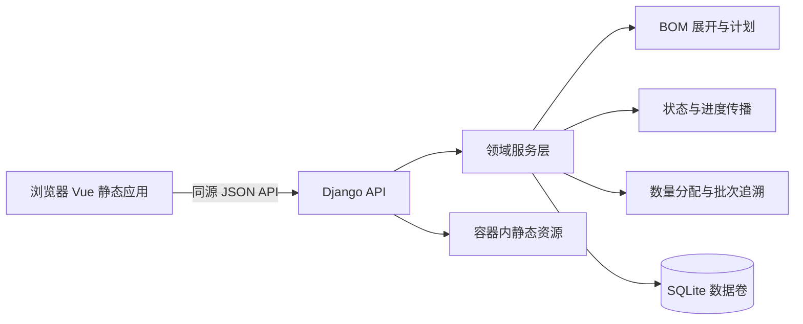

# 架构设计与决策记录

版本：2.0 · 原始基线：2026-10-10 · 修订：2026-10-11 · 状态：当前需求与实现基线。

## 组件与职责

领域职责如下；演示版合并在单个 aps 应用内，实际源码映射见 [17](17_Implementation_Acceptance.md)。

| 模块 | 内容 |
|---|---|
| catalog | Unit、Item、BOM 及结构校验 |
| sales | 销售草稿、确认、覆盖量和汇总进度 |
| planning | 版本化建议快照、拆合、数量守恒、确认与撤销 |
| production | 正式单、依赖、状态、进度传播、批次 |
| traceability | 图查询、路径、双向来源和分配明细 |
| cancellation | 已开工销售取消、分配扣量、BOM重展、完成量记账 |
| demo | 显式初始导入、清空重置、备份恢复与操作日志 |
| common | 精度、事务、幂等、版本、错误和编号 |

Vue 只显示后端计算结果；不能把前端计算作为开工、完成或数量合法的依据。所有写操作调用领域服务，不用 Django signal 隐式传播整个图。

## 事务与一致性

单容器运行一个应用 worker（Gunicorn gthread，4线程），避免演示版复杂写并发；仍必须有乐观版本和 SQLite 写事务，处理多浏览器、重试及未来线程变化。

- 对确认计划、进度传播、撤销、销售取消和重置使用短 `transaction.atomic()`；SQLite 配置 IMMEDIATE 事务模式，避免依赖无效的行锁。
- 大图计算可先在事务外根据快照生成候选结果，提交时校验 `data_revision`，失败要求刷新；不要在锁内执行文件导出或网络调用。
- 同事务更新图、缓存状态、数量分配、审计和幂等结果。`on_commit` 仅适合通知，不用于核心进度更新。
- 更改销售或 BOM 可用性时递增 data_revision；建议结构修改由 PlanRun.version 标识。进度写入使用生产单 version，并原子读取其依赖状态。
- SQLite 锁等待超时返回可重试 503；业务版本冲突返回 409，不能吞掉错误自动覆盖。

SQLite 不支持 `SELECT FOR UPDATE`；其限制和事务选项参见 [Django 数据库说明](https://docs.djangoproject.com/en/5.2/ref/databases/#sqlite-notes)。原子操作依据 [Django 事务文档](https://docs.djangoproject.com/en/5.2/topics/db/transactions/)。

## ADR

| 编号 | 决策 | 原因和代价 |
|---|---|---|
| ADR-001 | 后端Django5.2.18、Vue3.5.43、SQLite；本地Python3.13.1、Node24.21.0 | 满足用户技术栈，已生成实际解析的锁文件；完整开发工具版本及验证见16环境文档。 |
| ADR-002 | 一个运行容器，Vue 构建产物由 Python 应用静态服务组件提供 | 无需 Node 运行服务、Nginx 容器或跨域 API。构建阶段仍可使用 Node。 |
| ADR-003 | 生产单与生产子单同表，依赖使用独立多对多边 | 支持多父共享、不同路径深度和数量追溯，不能用唯一 parent_id 树代替。 |
| ADR-004 | 一正式生产单一产出批次，批次号存同一表 | 无批次拆装或多次产出的复杂生命周期，无需无意义的一对一批次表。 |
| ADR-005 | 建议采用版本化 JSON 图，正式生产采用规范化关系表 | 草稿结构变化频繁；确认时完整校验并原子落库。JSON schema 同 API 契约，不能当无结构随意存储。 |
| ADR-006 | 数量 scaled integer，进度输入 basis points，计算结果有理数 | 避免 SQLite/二进制浮点造成数量守恒或完成误判；代价是统一转换组件。 |
| ADR-007 | 正式图结构冻结，未开工修改用整计划撤销重建 | 普通编辑保持该规则；销售取消采用局部缩量和精确已完成量记账，保留共享批次，必须预览。 |
| ADR-008 | 状态由业务规则决定，总进度派生并缓存 | 100% 显示和实际完成不同；禁止修改计算结果字段。 |
| ADR-009 | 无身份模块 | 用户明确要求。访问环境由演示部署范围决定；默认绑定本机端口。 |
| ADR-010 | 同步排产、同步传播，前端操作后失效相关查询缓存 | 演示规模不引入 Redis、Celery、消息队列、WebSocket。可选定时刷新不影响正确性。 |
| ADR-011 | 使用确认不建库存流水 | 记录图边数量即可展示批次去向；不宣称记录了现场实际扫码投料。 |
| ADR-012 | 销售草稿即强制校验完整可用BOM | 前端筛选和后端校验同时执行，确认再次校验并冻结。 |
| ADR-013 | 取消用精确保留完成量作为进度下限 | 不把取消后的总进度强塞为自身进度；保持依赖门槛，超量忽略，不建库存。 |
| ADR-014 | 取消缩量采用消费者优先BOM重展及最大余数分配 | 拆批后需求可能重新取整，按合法单位处理多供应关系；保留无效边。 |
| ADR-015 | 浏览器回归使用专用端口和临时库 | 后端18081、前端15173，避免占用或写入演示容器8000；日常开发仍8000/5173。 |

## 算法复杂度和容量

无环检查、一次完整状态重算为 O(V+E)，图拓扑顺序可复用。BOM 按销售路径展开时路径数可能超过唯一物料数，必须预算节点/边总数；超预算整次失败并报告原因，不能悄悄截断层级。

迭代遍历无 Python 递归深度依赖。进度用有理数存在分母增长代价；以测试规模验证。当前默认保护阈值为20,000节点/50,000边，属于可配置资源上限，不是固定 BOM 深度。

状态缓存有 `graph_revision`，提供只读一致性检查。不得仅因有缓存就跳过服务端实时开工门槛。

## 日志与失败恢复

标准输出记录request_id、方法、路径、状态码和时长；业务错误码在JSON响应中。业务日志写 AuditEvent，人工进度变化写 ProgressEvent，自动传播变化写同请求的 AuditEvent。无 user_id。

失败事务完全回滚。服务重启不自动变更生产进度；完成状态、分配及幂等结果从数据卷恢复。首次空库默认只初始化单位和系统配置，不灌入演示业务数据；蒜蓉酱场景只能按18文档显式导入或恢复备份；当前不提供一键场景菜单。非空库禁止启动时自动重置。
