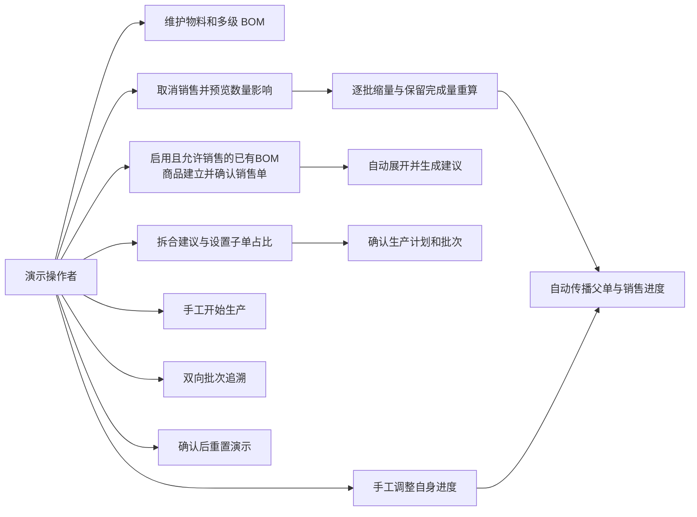
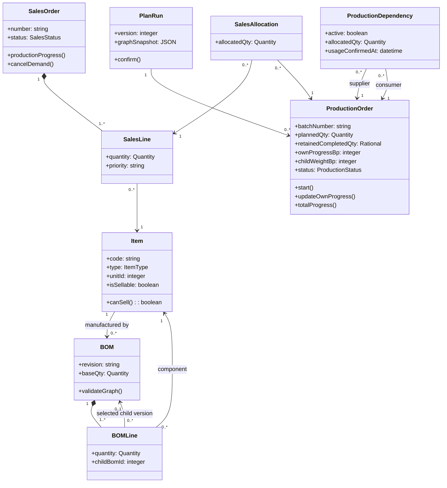
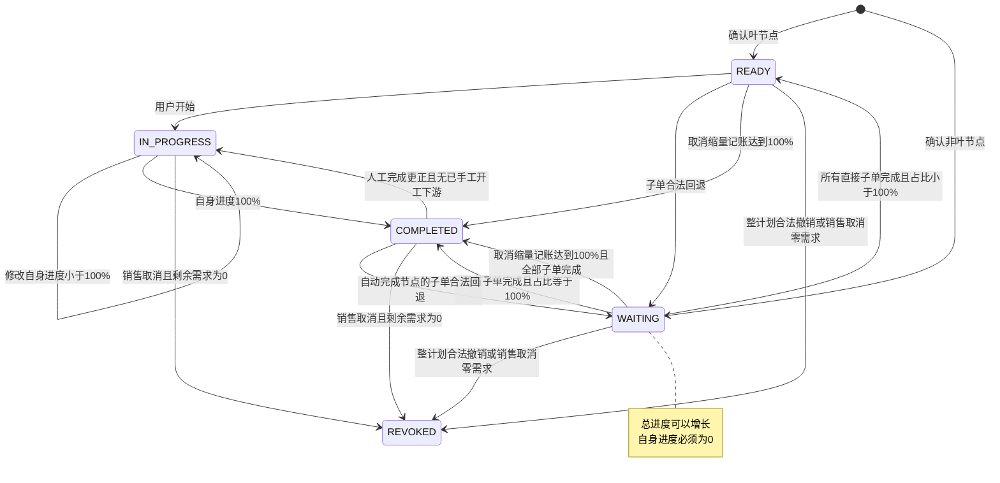
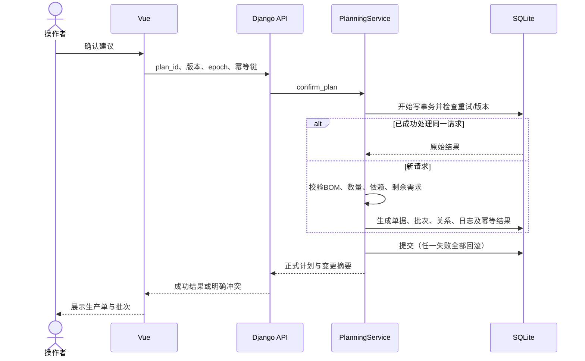
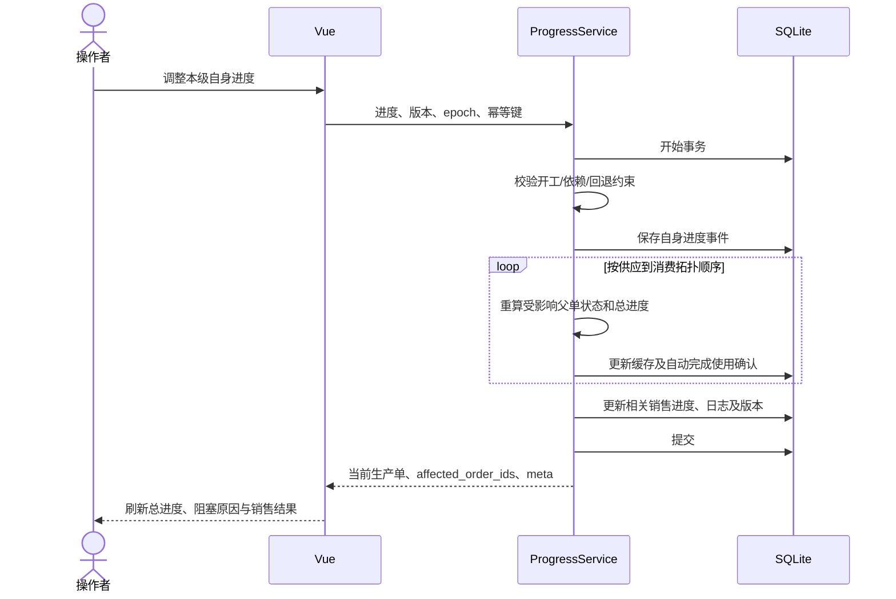
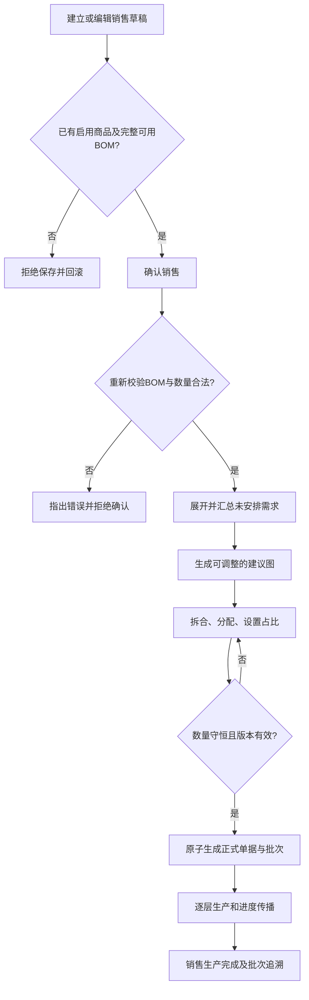
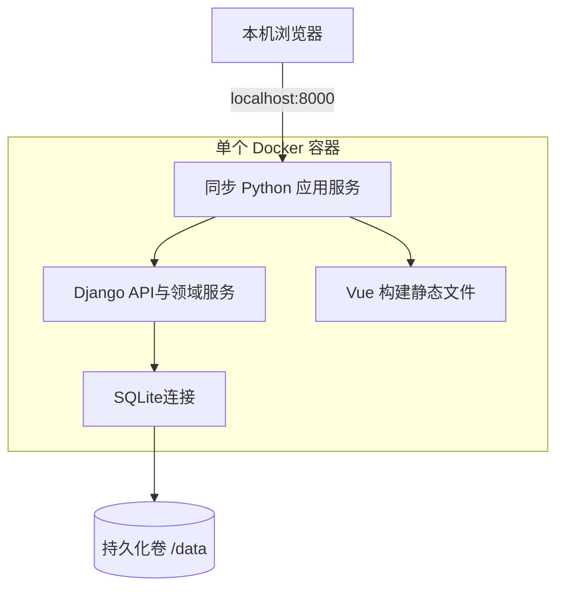
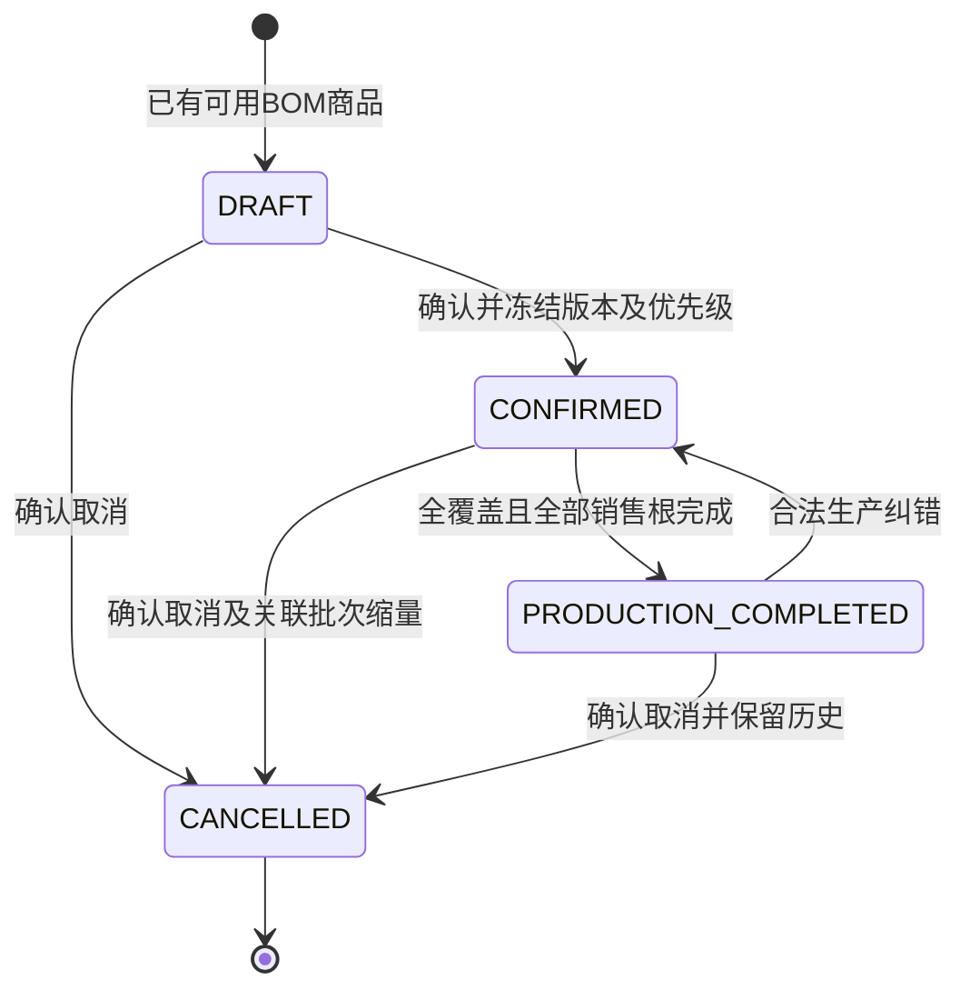
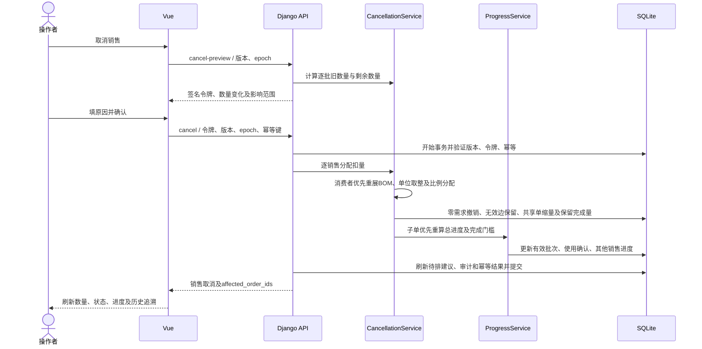

# UML 与流程设计

版本：2.1 · 原始基线：2026-10-10 · 修订：2026-10-11 · 状态：当前需求与实现基线。

Markdown 内含 UML 类、状态和时序图；PlantUML 标准用例、活动、部署图源见 [图源目录](diagrams/README.md)。所有图描述2.1当前基线，销售取消为正式计划冻结的专门缩量动作；图源结构检查与实际渲染验证区分记录。

## 用例概览

此概览是流程视图；标准 UML 用例图源为 [01_use_cases.puml](diagrams/01_use_cases.puml)。

## 领域类图

## 生产状态图

AUTO或未手工开工的CANCEL完成不填写手工开工时间；IN_PROGRESS 不会因合法子单回退转 WAITING，因为已有手工开工的下游会阻止该回退。生产单撤销为历史终态；演示重置不属于业务状态迁移。

## 计划确认时序

## 进度反馈时序

## 排产活动概览

## 部署视图

构建阶段 Node 与 Python 镜像层不等于两个运行容器；标准 UML 部署源见 [03_deployment.puml](diagrams/03_deployment.puml)。

## 销售状态图

## 销售取消时序

详细数学口径见 [业务规则](03_Business_Rules.md)；标准取消活动图源见 [04_sales_cancellation.puml](diagrams/04_sales_cancellation.puml)。
