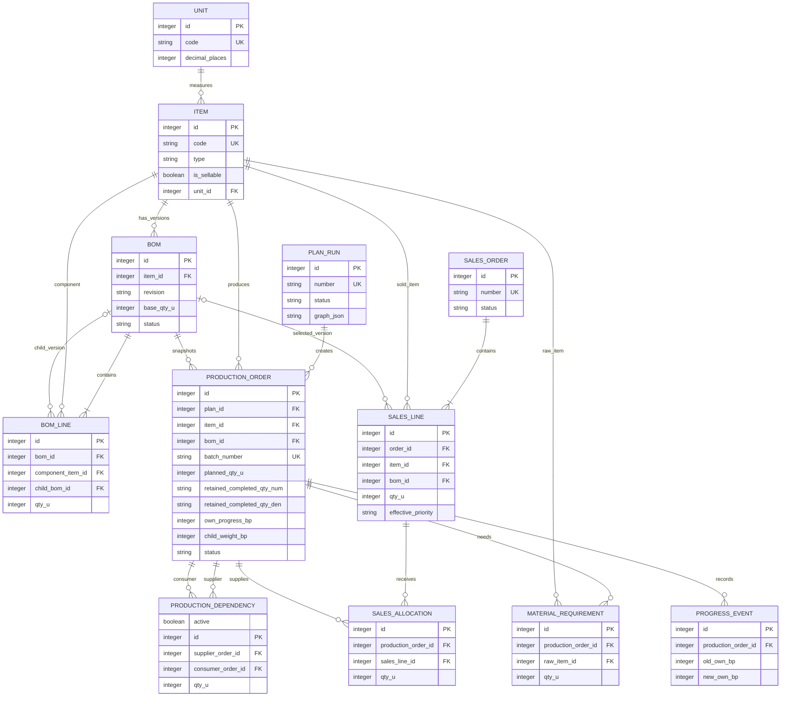

# 数据库设计与 ER 图

版本：2.0 · 原始基线：2026-10-10 · 修订：2026-10-11 · 状态：当前需求与实现基线。

## 建模约定

- 主键为整数；API 可见 id 不承担批次编号语义。所有外键启用约束，正式记录引用采用 PROTECT/RESTRICT。
- 可变聚合根有 version，创建/修改时间为 UTC；业务号码另外唯一。
- `qty_u` 为 10^6 放大的整数，API 十进制字符串；`*_bp` 为百分比 basis points，10000=100%。
- 进度有理数缓存为 `progress_num`、`progress_den` 两个 TEXT 整数字符串，分母为正，API 不使用它们做浮点运算。
- JSON 在数据库保存字符串/JSONField 内容；约束由应用验证，不能依赖 SQLite JSON 外键。
- 有效性由计划/单据状态决定，撤销时保留行和历史关系，查询合计必须排除REVOKED、无效依赖active=false及销售零分配。

## ER 图

图中包含业务实体。基础设施表 AuditEvent、IdempotencyRequest、NumberSequence、SystemState 单独说明，不伪造业务外键。替代计划 id 列表位于不可变审计元数据；读取时校验存在，演示重置同时清理相关业务数据。

## 字段字典

### Unit / Item

| 表 | 字段 | 约束/说明 |
|---|---|---|
| Unit | code、name、decimal_places | code 唯一；精度 0..6；被物料引用后精度冻结 |
| Item | code、name、type、unit_id、active、is_sellable、version | 类型 FINISHED/SEMI/RAW；引用后 code/type/unit 不可改；名称变更不覆盖历史快照 |

### BOM / BOMLine

| 表 | 字段 | 约束/说明 |
|---|---|---|
| BOM | item_id、revision、base_qty_u、status、version、activated_at | 唯一(item_id,revision)；base>0；每物料最多一条 ACTIVE（条件唯一索引） |
| BOM | description、created_at、updated_at | 版本说明及时间 |
| BOMLine | bom_id、position、component_item_id、child_bom_id?、qty_u | 唯一(bom_id,position)和(bom_id,component_item_id)；重复组件须先合并；用量>0 |

跨行规则：制造组件必须指向其明确版本；原料 child_bom_id=null。BOM 无环、类型限制和启用状态由激活/确认服务检查。ACTIVE/RETIRED 内容不可修改；新的默认版本不修改旧父 BOM 引用。

### SalesOrder / SalesLine

| 表 | 字段 | 约束/说明 |
|---|---|---|
| SalesOrder | number、customer_name、default_priority、status、notes、version | 编号唯一；无需 Customer/User 表；优先级HIGH/NORMAL/LOW |
| SalesOrder | confirmed_at?、production_completed_at?、cancelled_at?、cancel_reason? | 当前状态时间；首次/历史状态变化另保留日志 |
| SalesOrder | progress_num、progress_den | 派生缓存，不接受客户端写入 |
| SalesLine | order_id、position、item_id、qty_u、priority_override?、effective_priority?、bom_id? | 唯一(order,position)；qty>0；确认时固化有效优先级和选定 BOM |
| SalesLine | item_snapshot_json、bom_snapshot_json | 确认时记录编码、名称、单位及完整版本图；销售草稿可为空 |

已安排量、未安排量通过有效 SalesAllocation 汇总，不维护第二套可独立编辑余额。

### PlanRun

字段：number、formal_sequence?（确认后唯一）、status（DRAFT/SUPERSEDED/CONFIRMED/REVOKED）、schema_version、version、source_data_revision、dataset_epoch、graph_json、validation_json、replaces_plan_ids_json、confirmed_at、revoked_at、revoke_reason、created_at、updated_at。

graph_json 结构由 [API 契约](07_API_Contract.md) 定义。number 在建议创建时生成并保持不变，正式确认后另分配全局 formal_sequence 用于批次号；建议改版不消耗正式序号。CONFIRMED/REVOKED 的 graph_json 作为原确认快照不变；销售取消后实际当前数量以规范化生产/分配/原料表为准，graph_revision及审计记录缩量，不用旧快照覆盖当前批次。

### ProductionOrder

| 字段 | 约束/说明 |
|---|---|
| number、batch_number | 分别全局唯一；不从名称或外键临时拼接 |
| plan_id、plan_node_key | 唯一(plan_id,plan_node_key)，避免重复落库 |
| item_id、bom_id、item_snapshot_json、bom_snapshot_json | 制造物料及不可变快照，查询历史优先快照 |
| priority、planned_qty_u、rounding_surplus_qty_u | priority为HIGH/NORMAL/LOW；planned>0；0≤surplus≤planned |
| frozen_level、node_sequence | level≥0，无固定层数；计划内 node_sequence 唯一 |
| child_weight_bp?、own_progress_bp | 非叶 w 在 0..10000；叶 w=null；M 在 0..10000 |
| progress_num、progress_den、status、version、graph_revision | 派生进度和状态缓存，禁止普通 PATCH 写入 |
| retained_completed_qty_num、retained_completed_qty_den | TEXT 精确有理数，记录取消时保留的已完成量；默认0/1；显式纠错清除 |
| actual_started_at?、completed_at?、completion_mode? | HUMAN/AUTO/CANCEL；AUTO、CANCEL 可无开工时间；修正可清当前 completed_at |
| created_at、updated_at | UTC |

### ProductionDependency / SalesAllocation

| 表 | 字段 | 约束/说明 |
|---|---|---|
| ProductionDependency | supplier_order_id、consumer_order_id、qty_u、usage_confirmed_at? | 唯一(supplier,consumer)；supplier≠consumer；qty>0 |
| ProductionDependency | active | 默认true；取消后零需求边标false并保留旧qty用于历史追溯，开工及进度仅使用有效边 |
| ProductionDependency | component_snapshot_json、source_detail_json | 组件、单位、BOM 行及来源分解，主关系仍以 FK/qty 为准 |
| SalesAllocation | production_order_id、sales_line_id、qty_u、fulfillment_confirmed_at? | 唯一(production,line)；有效分配qty>0，取消后的分配qty=0保留关联；生产物料必须等于销售行物料 |

所有依赖在同一正式计划内，本期不把新销售追加给已有正式单。销售行可以跨多个计划分次安排。生产依赖方向定义为 supplier→consumer，图遍历向销售追溯时用此方向；向原料追溯时反向。

约束由确认服务在同一事务检查：同版本优先级、覆盖量、边对应 BOM 组件、生产量守恒、完整无环。SQL CHECK 不能表达跨表合计，不得假装单靠数据库即可保证。

### MaterialRequirement

字段：production_order_id、raw_item_id、bom_line_position、item_snapshot_json、theoretical_qty_num、theoretical_qty_den、qty_u、rounding_delta_u。唯一(production_order_id,bom_line_position)。仅记录本单 BOM 的直接原料；全图原料汇总按物料聚合，避免把每个父节点的完整原料展开重复相加。

理论量用有理数字符串，`rounding_delta_u` 为计划量与按存储精度表示理论量之间的差；精确差额由理论量与 qty_u 计算，不能用 delta 字段替代精确解释。

### ProgressEvent / AuditEvent

ProgressEvent：production_order_id、event_type（UPDATE/CORRECTION）、old_own_bp、new_own_bp、reason、request_id、created_at。记录人工自身进度变化，不覆盖旧事件。

AuditEvent：event_type、entity_type、entity_id_text、before_json、after_json、affected_entities_json、reason、request_id、dataset_epoch、created_at。逻辑引用保留单号/批次快照，无 user_id；自动变化也记录。

### IdempotencyRequest / NumberSequence / SystemState

- IdempotencyRequest：epoch、key、request_hash、method、path、status_code、response_json、created_at；唯一(epoch,key)。只保存已成功提交的结果；相同 key 不同 hash 返回 409。
- NumberSequence：name 唯一、next_value；在发号事务内更新；重置业务数据不删除序列。
- SystemState：单例 id=1、dataset_epoch、data_revision、active_plan_id?、demo_fixture_version、schema_version、updated_at。epoch 隔离重置前请求，revision 用于建议有效性。

## 索引与查询

当前显式索引：Item(type,active)、SalesOrder(status,default_priority)、ProductionOrder(status,priority)、AuditEvent(entity_type,entity_id_text)。外键默认生成索引；物料编码、业务编号、批次号、BOM版本、节点标识及分配唯一约束产生对应唯一索引。这里不将设计阶段曾建议的其他复合索引误写为已经创建。

批次查询按批次号精确定位后图遍历，不使用字符串 LIKE 推断亲子层级。列表分页默认100、最大500；图查询返回节点/边和路径信息，重复节点去重。

## 生命周期和迁移

初始迁移建表、CHECK、索引；演示种子通过独立命令加载，禁止把业务场景塞进不可回退的大型结构迁移。生产记录外键不级联删除；演示重置是明确例外，在事务内按依赖逆序清理。

现有迁移0001建立表、0002补充约束与索引、0003增加取消保留完成量字段、0004增加依赖有效标记。旧记录默认0/1及active=true，迁移不改变已有进度；结构升级后初始演示恢复使用18文档的v2备份。

数据库约束、领域校验、API 错误必须有一致测试。迁移失败不启动服务；发布前验证空库迁移、现有样例升级、备份恢复。没有 Postgres/MySQL 专有字段或服务依赖。
